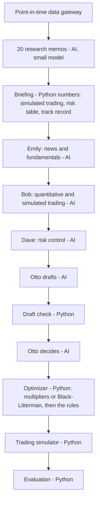

# QuantAgents 20-stock prototype (proto20): summary

_Results of 13 Nov 2026. Numbers only; every figure comes from stored runs and was computed by Python. The full tables are in `<storage>/reports/proto20/results.md` and `results.csv`, made with no AI calls._

## What we tested

Can a committee of AI analysts, modelled on the QuantAgents paper, make better monthly portfolio decisions than simply holding the companies at their market weight?

- **Companies:** the 20 largest NASDAQ-100 companies at the close of 4 Jan 2021, picked with that day's data only and then held fixed. They were 74.6% of the whole index.
- **Period:** January 2021 to December 2023, 36 monthly decisions. This is the paper's own test period.
- **Benchmark:** the same 20 companies at market weight. QQQ and the NASDAQ-100 index (^NDX) are shown for reference only.
- **Rules (checked every month):**
  - each stock stays between 0× and 2× its benchmark weight;
  - each sector stays within ±2 points of its benchmark weight;
  - no borrowing and no short selling;
  - trades happen at the next day's open and pay a 0.1% cost.
- **Models:** research memos on Claude Haiku 5.5; the committee on Claude Sonnet 5.5, with thinking off.
- **Point-in-time:** each decision sees only data published before the 4 pm close of its day. A check records every data read; there were 0 violations in all runs.

**Three versions:**

| version | how views become weights |
|---|---|
| Baseline | Otto gives each stock a multiplier of its benchmark weight (0× to 2×, in steps of 0.25); Python applies the rules |
| Enhanced | Otto gives a rating (strong sell … strong buy) with a confidence; Python turns them into weights with Black-Litterman and a 2%-a-year risk budget, then applies the same rules |
| Enhanced, names hidden | as Enhanced, but every company name and ticker is replaced by a code (X001 …) in everything the AI reads |

## How one month works

A picture version is in `architecture.svg`. **The AI never does maths:** every number in the briefing, every weight and every metric is computed by Python, and every AI answer is checked against a fixed format.

## Results, 2021 to 2023

| series | total return | per year (CAGR) | 2021 | 2022 | 2023 | volatility | Sharpe | Sortino | max drawdown | Calmar |
|---|---:|---:|---:|---:|---:|---:|---:|---:|---:|---:|
| Baseline | +42.61% | +12.64% | +35.57% | −37.40% | +68.04% | 26.47% | 0.49 | 0.70 | −40.31% | 0.31 |
| Enhanced | +42.94% | +12.73% | +36.07% | −37.56% | +68.24% | 26.46% | 0.50 | 0.71 | −40.46% | 0.31 |
| Enhanced, names hidden | +42.57% | +12.63% | +35.93% | −37.32% | +67.32% | 26.35% | 0.49 | 0.70 | −40.19% | 0.31 |
| **Benchmark (same 20, market weight)** | **+42.84%** | +12.70% | +35.46% | −37.58% | +68.94% | 26.62% | 0.49 | 0.70 | −40.49% | 0.31 |
| QQQ (reference) | +34.94% | +10.57% | +29.25% | −32.58% | +54.85% | 23.76% | 0.44 | 0.63 | −35.12% | 0.30 |
| ^NDX (reference) | +32.54% | +9.91% | +28.56% | −32.97% | +53.81% | 24.06% | 0.42 | 0.59 | −35.56% | 0.28 |

**Against the benchmark** (this measures the committee's skill):

| version | tracking error | information ratio (90% interval) | active Carhart alpha per year (t) | turnover a month | trading costs (3 years) | red flags |
|---|---:|---|---:|---:|---:|---:|
| Baseline | 0.59% | −0.16 (−1.00 to +0.69) | −0.15% (−0.46) | 7.6% | 0.30% | 0 |
| Enhanced | 0.40% | −0.05 (−1.17 to +0.82) | −0.05% (−0.22) | 6.1% | 0.24% | 0 |
| Enhanced, names hidden | 0.55% | −0.24 (−1.25 to +0.64) | −0.15% (−0.58) | 6.6% | 0.26% | 0 |

**Diversification** (average over the 36 months): ENT (entropy of weights) is 2.45 to 2.46 for the three versions and 2.47 for the benchmark. ENB (effective number of bets) is 1.79 to 1.80, against 1.76 for the benchmark.

**What this means:**
- **No measurable skill.** All three versions ended within 0.4 points of the benchmark. Every 90% interval for the information ratio includes zero, and every active alpha t-statistic is well below 2.
- **The committee was cautious.** In the baseline, 559 of 720 views kept the benchmark weight. In the enhanced versions, about 460 of 720 were "hold", and 81 to 89% of confidences were 0.2 or lower (the highest was 0.5).
- **It behaved responsibly.** There were no rule breaks, no future data and no invalid answers in 108 monthly decisions. Trading costs were 0.24 to 0.30% over three years.
- **Hiding names changed little.** The visible and hidden versions differ by 0.4 points, with similar view accuracy. So there's no sign that the AI relied on remembering these famous companies. It's a weak test, though, because size alone identifies a giant.
- The 20 companies themselves beat QQQ and ^NDX by 8 to 10 points: big technology companies led in 2021 to 2023. **That gap comes from which companies were chosen, not from the AI.**

## Next to the paper (different setups)

| | QuantAgents paper (reported) | proto20 baseline | proto20 enhanced | same-20 benchmark | ^NDX |
|---|---:|---:|---:|---:|---:|
| total return, 2021 to 2023 | about 300% | +42.61% | +42.94% | +42.84% | +32.54% (the paper reports 32.5%) |
| Sharpe | 3.11 | 0.49 | 0.50 | 0.49 | 0.42 |
| max drawdown | 16.9% | 40.31% | 40.46% | 40.49% | 35.56% |
| other Table 2 columns (ARR, Calmar, Sortino, volatility, ENT, ENB) | _copy from the paper's Table 2_ | see above | see above | see above | see above |

Our ^NDX return matches the paper's index figure (32.5%), so the two periods line up. The setups differ:
- Our committee sees only point-in-time data.
- It is held to benchmark-relative rules: 0× to 2× per stock and ±2 points per sector.
- It works on 20 fixed companies.

The paper itself warns that its backtest "may be affected by potential LLM information leakage"; our point-in-time gateway and names-hidden run test exactly that. **We do not claim that anything beats the NASDAQ-100.**

## How good were the views?

Each view is scored on the stock's return over the next 3 months minus the benchmark's return. For a "×1.00" or "hold" view, this is just the average.

**Baseline** (multiplier views; rank IC +0.091):

| view | count | average 3-month excess return | hit rate |
|---|---:|---:|---:|
| ×0.50 | 6 | +15.21% | 33% |
| ×0.75 | 106 | −2.85% | 60% |
| ×1.00 | 559 | +0.35% | – |
| ×1.25 | 48 | +1.04% | 56% |
| ×1.50 | 1 | −20.22% | 0% |

**Enhanced** (ratings; rank IC +0.052):

| rating | count | average 3-month excess return | hit rate |
|---|---:|---:|---:|
| strong sell | 1 | −6.26% | 100% |
| sell | 137 | −0.85% | 58% |
| hold | 458 | +0.43% | – |
| buy | 124 | −0.47% | 48% |

**Enhanced, names hidden** (ratings; rank IC +0.058):

| rating | count | average 3-month excess return | hit rate |
|---|---:|---:|---:|
| strong sell | 4 | +25.66% | 50% |
| sell | 141 | −1.60% | 57% |
| hold | 456 | +0.56% | – |
| buy | 119 | −0.99% | 50% |

The baseline's underweights did lag (−2.85% on 106 views, right 60% of the time), but its few overweights gained only a little. In the enhanced runs, buys did worse than holds. A rank IC of +0.05 to +0.09 is a weak signal, and the counts in the extreme rows are too small to read anything into.

## A sample decision (enhanced, 1 June 2022)

What Otto decided in the 2022 sell-off, and what Python turned it into. The full meeting is in `sample_transcript_proto20_paper_enhanced_2022-06-01.md`: every member's question and answer.

| company | benchmark | rating (confidence) | final weight | final multiplier |
|---|---:|---|---:|---:|
| AAPL | 21.59% | hold (0.1) | 21.33% | ×0.99 |
| MSFT | 18.28% | buy (0.2) | 18.42% | ×1.01 |
| AMZN | 11.11% | sell (0.2) | 10.76% | ×0.97 |
| AVGO | 2.10% | buy (0.5) | 2.95% | ×1.41 |
| PEP | 2.07% | buy (0.2) | 2.70% | ×1.31 |
| CSCO | 1.68% | sell (0.2) | 1.17% | ×0.70 |
| PYPL | 0.86% | sell (0.5) | 0.50% | ×0.59 |
| NFLX | 0.77% | sell (0.4) | 0.58% | ×0.76 |
| _12 other companies_ | | 7 holds, 5 low-confidence buys or sells (0.1 to 0.2) | | ×0.91 to ×1.21 |

The meeting cost $0.23, using 5 API calls with 20 memos read from the cache. Higher confidence gives a bigger move (AVGO and PYPL, at 0.5), and moves are in proportion to each company's benchmark weight.

## Cost

| run | cost |
|---|---:|
| Baseline, 36 months | $7.96 |
| Enhanced, 36 months | $8.14 |
| Enhanced, names hidden, 36 months | $8.47 |
| Pilots and tests | $0.99 |
| **Total** | **$25.57 (about Rs 2,250)** of the $40 budget |

About $0.23 per monthly decision. The shared briefing is prompt-cached, which saved about 40% on the committee.

## Limitations (read with care)

1. **Short sample.** 36 months gives alpha t-statistics little power. The 90% bootstrap intervals show how wide the uncertainty is.
2. **20 mega-caps, chosen on one day.** The choice uses no hindsight, but the results can't be compared with the full NASDAQ-100. Apple alone is about 20% of the benchmark.
3. **Tight rules.** The 0× to 2× and ±2-point rules keep the portfolio close to the benchmark by design, so big wins or losses were never possible.
4. **One run per version.** AI answers vary, and a second run could give slightly different numbers. The cache makes each run exactly repeatable, but it does not make the AI's choices certain.
5. **Names hidden is a weak control.** Size, sector and figures still identify the biggest companies.
6. **The Carhart alpha of the 20 companies** (+8.6% a year against the whole US market) comes from which companies were chosen. The committee's own alpha is the active alpha, which is about zero.
7. **Data.** The free data sources were cleaned and checked (see the problems log); two receipt (ADR) ratios, JD and PDD, are still to be double-checked by hand.
8. **Trading model.** A flat 0.1% cost with trades at the next open. There's no market-impact model, which is reasonable for these very liquid stocks.

## Next step

The full run: about 100 NASDAQ-100 companies, from 2015 to 2023. It needs the licensed price data for companies that left the index (Norgate), so the universe is free of survivorship bias. It also needs its own cost forecast and approval before any spending.
